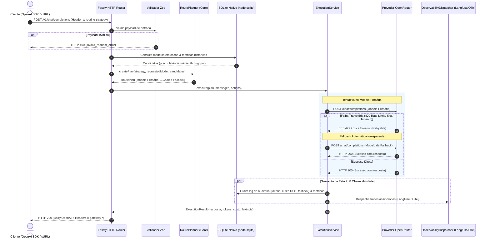

# AGENTS.md — Project Governance & AI Pair Programming

> Documento central de governança técnica, arquitetura e colaboração com agentes de IA.
>
> Este documento estabelece as diretrizes que devem ser seguidas por qualquer agente de IA que participe do desenvolvimento deste projeto.
>
> **Regra principal:** Nenhuma implementação deve começar sem que o agente compreenda o contexto, valide os requisitos e alinhe a abordagem técnica com o desenvolvedor.

---

# 1. Project Overview

## 1.1. Identificação

- **Nome do projeto:** Gateway de Roteamento Inteligente, Fallback e Observabilidade de Modelos
- **Descrição:** Gateway HTTP de alto desempenho para LLMs com roteamento dinâmico baseado em critérios (Preço, Latência ou Throughput), fallback automático e observabilidade profunda (OpenTelemetry, Langfuse e SQLite nativo).
- **Objetivo principal:** Garantir alta disponibilidade, previsibilidade de custos e métricas detalhadas no consumo de múltiplos modelos de IA via OpenRouter, mantendo 100% de compatibilidade com a especificação da OpenAI.
- **Público-alvo:** Aplicações clientes, microsserviços e desenvolvedores que consomem LLMs e exigem resiliência operacional, otimização de custos e auditoria contínua.
- **Status:** PLANNING
- **Responsável técnico:** AI Pair Programming Team

## 1.2. Visão do Produto

Aplicações modernas dependem criticamente de modelos de linguagem (LLMs), mas sofrem com instabilidades frequentes de provedores, esgotamento repentino de limites de taxa (rate limits 429), custos voláteis e falta de visibilidade sobre tempos de resposta e falhas.

Este produto atua como uma camada inteligente intermediária (*gateway reverso*) entre as aplicações clientes e a infraestrutura de modelos via OpenRouter. A aplicação valida as requisições na borda, seleciona dinamicamente o modelo ideal segundo o critério solicitado, executa fallback imediato para modelos secundários em caso de erro transitório ou timeout, registra histórico e métricas de desempenho em SQLite embutido e exporta traces e métricas para Langfuse e OpenTelemetry.

## 1.3. Escopo

### Funcionalidades principais
- **Contrato OpenAI-Compatible:** Endpoint `POST /v1/chat/completions` totalmente compatível com SDKs OpenAI, retornando payload oficial e enriquecido com metadados em headers HTTP.
- **Validação Estrita:** Validação de schemas de requisição e configuração na inicialização com Zod (*fail-fast*).
- **Roteamento Inteligente Multimodelo:** Escolha dinâmica entre modelos elegíveis baseada em:
  - `price`: Seleciona o modelo de menor custo por milhão de tokens (baseado no catálogo do OpenRouter).
  - `latency`: Seleciona o modelo com menor latência média histórica registrada no SQLite.
  - `throughput`: Seleciona o modelo com melhor vazão histórica de tokens por segundo.
- **Fallback Automático e Resiliente:** Em caso de erro 429 (rate limit), 5xx (serviço indisponível) ou timeout no modelo primário, comuta de forma transparente para modelos secundários configurados.
- **Persistência de Estado (Stateful):** Armazenamento embutido via `node:sqlite` nativo do Node.js 24 para métricas históricas de latência, auditoria de transações, contagem de tokens e cache de catálogo.
- **Observabilidade Total:** Traces de geração, custos e histórico de prompts no Langfuse; métricas e rastreamento distribuído no OpenTelemetry; testes automatizados de avaliação de prompts (*Evaluation Tests*).

### Fora do escopo
- Interface visual (dashboard web frontend) proprietária nesta fase (métricas são consumidas via Langfuse/OTel/API).
- Treinamento ou fine-tuning de modelos.
- Gateways para provedores legados sem compatibilidade com o padrão OpenAI/OpenRouter.

### Restrições e premissas
- Execução no runtime Node.js 24 com suporte a TypeScript nativo.
- Sem dependência de bancos de dados externos pesados; uso exclusivo do SQLite embutido nativo (`node:sqlite`).
- Testes automatizados executados pelo test runner nativo `node:test` e `node:assert/strict`.

---

# 2. Architecture & Technical Decisions

## 2.1. Padrão Arquitetural

- **Arquitetura adotada:** Clean Architecture / Hexagonal simplificada (Ports & Adapters)
- **Estilo de comunicação:** REST HTTP compatível com a especificação da OpenAI
- **Organização:** Monorepo modular
- **Estratégia de persistência:** Stateful com SQLite embutido nativo (`node:sqlite`) em arquivo local (com suporte a in-memory para testes unitários)

### Princípios arquiteturais

1. Separação de responsabilidades (Domínio isolado de transporte HTTP e provedores externos).
2. Baixo acoplamento e alta coesão entre o motor de roteamento e clientes upstream.
3. Inversão de dependência e testabilidade sem I/O real em testes unitários.
4. Fail-Fast na inicialização para variáveis de ambiente inválidas.
5. Simple Design (XP): priorizar a solução mínima funcional sem abstrações prematuras.
6. Enriquecimento sem quebra de contrato: dados analíticos adicionais trafegam preferencialmente via headers HTTP (`x-gateway-*`).

## 2.2. Fluxo Visual de Requisição



## 2.3. Regras de Dependência

- **Core / Domain:** Contém entidades, regras de roteamento (estratégias), contratos de repositório e cálculo de custos. Não depende de Fastify, SQLite ou bibliotecas externas de I/O.
- **Services:** Casos de uso de orquestração de requisição, catálogo e fallback. Dependem apenas das abstrações do Core.
- **Infrastructure:** Implementa os adaptadores (Fastify HTTP, OpenRouter Client, SQLite Repository, Langfuse, OpenTelemetry).

## 2.3. Architecture Decision Records (ADR)

Decisões arquiteturais relevantes devem ser documentadas em `docs/architecture/decisions/`.

Decisões aprovadas iniciais:
- **ADR-001:** Adoção do padrão de contrato OpenAI (`POST /v1/chat/completions`) e headers `x-gateway-*`.
- **ADR-002:** Persistência embutida com `node:sqlite` nativo do Node.js 24 para estado, auditoria e métricas.
- **ADR-003:** Roteamento dinâmico baseado em catálogo sincronizado do OpenRouter e métricas móveis locais.

---

# 3. Technology Stack

## 3.1. Tecnologias

| Camada | Tecnologia | Versão |
|---|---|---|
| Runtime | Node.js (com TypeScript nativo) | 24.x LTS |
| Backend Framework | Fastify | 5.x |
| Schema & Validation | Zod | 3.x |
| Database / Persistência | SQLite (`node:sqlite` nativo) | Node.js 24 built-in |
| Upstream Client | OpenRouter / OpenAI SDK compatível | Latest |
| Observabilidade | Langfuse SDK + OpenTelemetry API/SDK | Latest |
| Test Runner | `node:test` + `node:assert/strict` | Node.js 24 built-in |
| Logging | Pino (integrado ao Fastify) | Built-in Fastify |

## 3.2. Bibliotecas e Frameworks

| Biblioteca | Responsabilidade | Serviço/Módulo |
|---|---|---|
| `fastify` | Servidor HTTP de alta performance | `infrastructure/http` |
| `zod` | Validação de schemas e envs | `config`, `infrastructure/http` |
| `langfuse` | Rastreamento analítico de prompts/custos | `infrastructure/observability` |
| `@opentelemetry/api` | Instrumentação de traces e métricas APM | `infrastructure/observability` |

Regras:

- Priorizar bibliotecas consolidadas e mantidas.
- Evitar adicionar dependências sem justificativa.
- Verificar compatibilidade de versões.
- Não substituir tecnologias definidas sem aprovação.
- Documentar novas dependências relevantes.

---

# 4. Repository Structure

## 4.1. Estrutura de Diretórios

Estrutura aprovada:

```text
.
├── docs/
│   ├── architecture/
│   │   └── decisions/
│   ├── requirements/
│   ├── technical/
│   ├── development/
│   │   ├── development-plan.md
│   │   └── progress.md
│   └── AGENTS.md
│
├── src/
│   ├── config/                            # Validação de variáveis de ambiente com Zod
│   ├── core/                              # Entidades de domínio, erros e estratégias puras
│   │   ├── entities/
│   │   ├── errors/
│   │   └── strategies/                    # Estratégias (Price, Latency, Throughput)
│   ├── services/                          # Orquestração (Roteamento, Fallback, Catálogo)
│   └── infrastructure/                    # Adaptadores de entrada e saída
│       ├── database/                      # Repositório SQLite embutido (node:sqlite)
│       ├── http/                          # Servidor Fastify, rotas e middlewares
│       │   ├── routes/
│       │   └── schemas/
│       ├── providers/                     # Cliente OpenRouter
│       └── observability/                 # Langfuse e OpenTelemetry
│
├── tests/
│   ├── unit/                              # Regras de negócio, estratégias e fallback
│   ├── integration/                       # Rotas Fastify (fastify.inject) e SQLite
│   └── evals/                             # Evaluation tests de prompts
│
├── data/                                  # Diretório local do banco SQLite (ignorado no git)
├── .env.example
├── .gitignore
├── package.json
├── tsconfig.json
└── README.md
```

## 4.2. Organização de Arquivos

O agente deve respeitar as seguintes convenções:

- Models & Entities: `src/core/entities/`
- Errors de Domínio: `src/core/errors/`
- Estratégias de Roteamento: `src/core/strategies/`
- Services / Use Cases: `src/services/`
- Repositório / Persistência: `src/infrastructure/database/`
- Servidor HTTP & Rotas: `src/infrastructure/http/routes/`
- Validações de Borda: `src/infrastructure/http/schemas/`
- Provedores Externos (OpenRouter): `src/infrastructure/providers/`
- Observabilidade (Langfuse/OTel): `src/infrastructure/observability/`
- Configuração & Env: `src/config/`
- Testes: `tests/unit/`, `tests/integration/` e `tests/evals/`

Não criar novos diretórios ou reorganizar estruturas existentes sem justificativa técnica.

---

# 5. Environment & Configuration

## 5.1. Variáveis de Ambiente

Todas as configurações sensíveis e operacionais são validadas no boot (`src/config/env.ts`) via Zod.

| Variável | Descrição | Obrigatória | Padrão |
|---|---|---|---|
| `NODE_ENV` | Ambiente de execução (`development`, `test`, `production`) | Não | `development` |
| `PORT` | Porta do servidor HTTP | Não | `3000` |
| `HOST` | Host para bind da aplicação | Não | `0.0.0.0` |
| `DATABASE_PATH` | Caminho do arquivo SQLite local | Não | `./data/gateway.db` |
| `OPENROUTER_API_KEY` | Chave de API do OpenRouter | Sim | - |
| `OPENROUTER_BASE_URL` | URL base do OpenRouter | Não | `https://openrouter.ai/api/v1` |
| `DEFAULT_ROUTING_STRATEGY` | Estratégia padrão (`price`, `latency`, `throughput`) | Não | `price` |
| `REQUEST_TIMEOUT_MS` | Timeout limite para chamadas a modelos | Não | `15000` |
| `LANGFUSE_PUBLIC_KEY` | Chave pública do Langfuse (opcional em dev/test) | Não | - |
| `LANGFUSE_SECRET_KEY` | Chave secreta do Langfuse | Não | - |
| `LANGFUSE_BASEURL` | URL do servidor Langfuse | Não | `https://cloud.langfuse.com` |

## 5.2. Convenções

- Nunca armazenar credenciais diretamente no código.
- O arquivo `.env` nunca deve ser versionado no Git; apenas `.env.example`.
- Falha imediata (*fail-fast*): se uma variável obrigatória estiver ausente no boot, o processo encerra com código 1 e mensagem explicativa.
- Em ambiente de testes (`NODE_ENV=test`), o SQLite deve operar por padrão em memória (`:memory:`) para isolamento total.

---

# 6. Domain Rules & Business Logic

## 6.1. Regras de Domínio

1. **Roteamento por Critério:**
   - **Preço (`price`):** Ordena os modelos elegíveis pelo menor custo somado de prompt + completion por 1M tokens, conforme tabela de preços atual do catálogo.
   - **Latência (`latency`):** Ordena os modelos pela menor média móvel de tempo de resposta recente (armazenada no SQLite). Caso um modelo ainda não possua histórico, recebe prioridade de amostragem ou posicionamento intermediário.
   - **Throughput (`throughput`):** Ordena os modelos pela maior taxa de tokens gerados por segundo (tokens/sec histórico).
2. **Fallback Automático:**
   - Se o modelo primário selecionado falhar com código HTTP 429 (Rate Limit), 5xx (Server Error/Indisponibilidade) ou disparar Timeout configurado, a requisição NÃO deve ser abortada imediatamente.
   - O orquestrador aciona sequencialmente o próximo modelo na fila de fallback.
   - O erro final só é propagado ao cliente se todos os modelos elegíveis da cadeia falharem.
3. **Auditoria & Contabilização de Custos (Stateful):**
   - Toda requisição bem-sucedida ou com falha persistente registra no SQLite: `request_id`, `timestamp`, `strategy`, `model_requested`, `model_executed`, `prompt_tokens`, `completion_tokens`, `cost_usd`, `latency_ms` e `fallback_used`.
4. **Contrato de Resposta (OpenAI Standard):**
   - Resposta compatível com JSON da OpenAI.
   - Headers adicionais obrigatórios: `x-gateway-strategy`, `x-gateway-model-requested`, `x-gateway-model-executed`, `x-gateway-fallback-triggered`, `x-gateway-fallback-attempts`, `x-gateway-cost-usd`, `x-gateway-latency-ms`.

## 6.2. Services

- `CatalogService`: Responsável por buscar e atualizar periodicamente a lista de modelos disponíveis no OpenRouter e sincronizar com o banco local.
- `RouterService`: Responsável por receber o critério (`price`, `latency`, `throughput`), consultar o estado e ordenar a lista de modelos candidatos (primário + cadeia de fallback).
- `ExecutionService`: Orquestra o disparo da chamada para o OpenRouter, gerencia os timeouts, intercepta erros elegíveis para fallback e coleta as métricas de resposta.

## 6.3. Jobs & Background Workers

- **Sincronizador de Catálogo:** Job periódico leve ou cache com TTL que atualiza a tabela de preços e modelos do OpenRouter sem bloquear requisições em andamento.

## 6.4. Models & Data

- Tabela `requests_log`: Histórico de requisições, tokens e custos para auditoria.
- Tabela `model_metrics`: Amostras recentes de latência e throughput por modelo.
- Tabela `models_cache`: Catálogo local de modelos e custos do OpenRouter.

## 6.5. Exemplos de Requisição para Teste

### Exemplo 1: Via cURL (Roteamento Dinâmico por Menor Preço)

```bash
curl -i -X POST http://localhost:3000/v1/chat/completions \
  -H "Content-Type: application/json" \
  -H "x-routing-strategy: price" \
  -d '{
    "model": "gateway/auto-cheap",
    "messages": [
      {
        "role": "user",
        "content": "Explique em uma frase o conceito de Fail-Fast na engenharia de software."
      }
    ],
    "temperature": 0.7
  }'
```

#### Exemplo de Resposta Recebida:

```http
HTTP/1.1 200 OK
content-type: application/json; charset=utf-8
x-gateway-strategy: price
x-gateway-model-requested: meta-llama/llama-3.1-8b-instruct
x-gateway-model-executed: meta-llama/llama-3.1-8b-instruct
x-gateway-fallback-triggered: false
x-gateway-fallback-attempts: 0
x-gateway-cost-usd: 0.000003
x-gateway-latency-ms: 485

{
  "id": "chatcmpl-gateway-e2f91a0c",
  "object": "chat.completion",
  "created": 1729000000,
  "model": "meta-llama/llama-3.1-8b-instruct",
  "choices": [
    {
      "index": 0,
      "message": {
        "role": "assistant",
        "content": "Fail-Fast é o princípio de interromper imediatamente a execução ao detectar um erro ou inconsistência, facilitando o diagnóstico e prevenindo estados corrompidos."
      },
      "finish_reason": "stop"
    }
  ],
  "usage": {
    "prompt_tokens": 22,
    "completion_tokens": 28,
    "total_tokens": 50
  }
}
```

### Exemplo 2: Via OpenAI SDK (TypeScript / Node.js)

```typescript
import OpenAI from 'openai';

const client = new OpenAI({
  baseURL: 'http://localhost:3000/v1',
  apiKey: 'qualquer-string-ou-dummy', // O gateway utiliza sua OPENROUTER_API_KEY interna
  defaultHeaders: {
    'x-routing-strategy': 'latency', // Otimiza para o modelo com menor latência média
  },
});

async function main() {
  const completion = await client.chat.completions.create({
    model: 'gateway/auto-fast',
    messages: [{ role: 'user', content: 'Qual é o planeta mais próximo do Sol?' }],
  });

  console.log('Resposta:', completion.choices[0].message.content);
}

main();
```

### Exemplo 3: Requisição com Modelo Específico e Fallback Automático

```bash
# Se o modelo solicitado (ex: anthropic/claude-3.5-sonnet) estiver sob Rate Limit (429) ou indisponível,
# o Gateway comuta automaticamente para o próximo melhor modelo e sinaliza nos headers:
curl -i -X POST http://localhost:3000/v1/chat/completions \
  -H "Content-Type: application/json" \
  -H "x-routing-strategy: price" \
  -d '{
    "model": "anthropic/claude-3.5-sonnet",
    "messages": [
      { "role": "user", "content": "Olá!" }
    ]
  }'

# Headers em caso de fallback disparado:
# x-gateway-model-requested: anthropic/claude-3.5-sonnet
# x-gateway-model-executed: openai/gpt-4o-mini
# x-gateway-fallback-triggered: true
# x-gateway-fallback-attempts: 1
```

---

# 7. Code Quality Standards

## 7.1. Princípios

O desenvolvimento deve observar:

- SOLID.
- DRY.
- KISS.
- Separation of Concerns.
- Clean Code.
- Fail Fast.
- Explicit over Implicit.

## 7.2. Convenções de Código

- Seguir as convenções oficiais da linguagem.
- Utilizar nomes descritivos.
- Manter métodos pequenos e coesos.
- Evitar comentários que apenas repetem o código.
- Documentar decisões e comportamentos não óbvios.
- Evitar código morto e abstrações sem utilização.

## 7.3. Tratamento de Erros

- Não utilizar exceções como fluxo normal de controle.
- Não ocultar exceções.
- Preservar informações relevantes para diagnóstico.
- Padronizar respostas de erro no formato OpenAI (`{ "error": { "message": "...", "type": "gateway_error", "code": 500 } }`).
- Não expor detalhes internos da aplicação ao consumidor da API.

---

# 8. Testing Strategy

## 8.1. Estratégia de Testes

| Tipo | Objetivo | Ferramenta |
|---|---|---|
| Unitários | Regras de cálculo de custo, ordenação de estratégias, fallback | `node:test` + `node:assert/strict` |
| Integração | Rotas Fastify (`fastify.inject`), persistência no SQLite e ciclo de fallback com mocks | `node:test` + Fastify Inject |
| Evaluation Tests | Avaliação automatizada de qualidade e consistência de prompts | `tests/evals/` |
| Contrato | Compatibilidade com especificações OpenAI e OpenRouter | `node:test` |

## 8.2. Test-Driven Development (TDD)

Adotar o ciclo:

1. **Red:** escrever um teste que represente o comportamento esperado e falhe.
2. **Green:** implementar o mínimo necessário para passar.
3. **Refactor:** melhorar a implementação preservando os testes.

Regras:

- Não implementar funcionalidades complexas sem definir previamente seus critérios de aceitação.
- Não escrever testes que apenas reproduzam a implementação.
- Testar comportamentos, não detalhes internos.
- Não remover ou enfraquecer testes para fazer uma implementação passar.
- Executar os testes relevantes após cada alteração.

---

# 9. AI Pair Programming — Extreme Programming

## 9.1. Papel do Agente

O agente deve atuar como um parceiro técnico de programação, não como um executor autônomo de tarefas extensas.

Responsabilidades:

- Analisar problemas antes de propor soluções.
- Explicar decisões técnicas relevantes.
- Questionar requisitos inconsistentes.
- Propor alternativas quando houver trade-offs.
- Desenvolver incrementalmente.
- Manter o desenvolvedor envolvido nas decisões.
- Priorizar soluções simples e testáveis.

O desenvolvedor permanece responsável pelas decisões finais.

## 9.2. Ciclo de Desenvolvimento

### Etapa 1 — Understand
- Ler este documento.
- Identificar o contexto da tarefa.
- Consultar os documentos relevantes.
- Inspecionar a implementação existente.
- Identificar dependências e impactos.

### Etapa 2 — Discuss
Antes de implementar:

- Apresentar a interpretação do requisito.
- Identificar dúvidas e ambiguidades.
- Apresentar a abordagem técnica proposta.
- Identificar os arquivos que provavelmente serão modificados.
- Apontar riscos e impactos arquiteturais.

Aguardar alinhamento do desenvolvedor quando houver decisões relevantes ou ambiguidades que alterem o resultado.

### Etapa 3 — Plan
Dividir a implementação em pequenas unidades de trabalho.

Cada unidade deve possuir:

- Objetivo.
- Comportamento esperado.
- Arquivos envolvidos.
- Testes necessários.
- Critérios de aceitação.

### Etapa 4 — Test First
- Definir os testes antes da implementação.
- Escrever testes que expressem o comportamento esperado.
- Validar que os testes falham pelo motivo esperado.

### Etapa 5 — Implement
- Implementar somente o necessário.
- Evitar antecipar funcionalidades futuras.
- Não modificar áreas não relacionadas.
- Seguir os padrões existentes.

### Etapa 6 — Refactor
- Eliminar duplicações.
- Melhorar legibilidade.
- Revisar responsabilidades.
- Verificar aderência à arquitetura.
- Preservar os testes existentes.

### Etapa 7 — Review
Apresentar:

- O que foi implementado.
- Arquivos modificados.
- Testes executados e resultados.
- Decisões técnicas tomadas.
- Débitos técnicos identificados.
- Próximo incremento recomendado.

## 9.3. Práticas de Extreme Programming

| Prática | Aplicação |
|---|---|
| Small Releases | Entregas pequenas e frequentes |
| TDD | Testes antes da implementação |
| Refactoring | Melhoria contínua |
| Simple Design | Solução mais simples que atende ao requisito |
| Pair Programming | Desenvolvedor e IA trabalhando em conjunto |
| Continuous Integration | Integração e validação frequentes |
| Collective Ownership | Código compreensível e mantido por todos |
| Feedback | Validação constante dos resultados |

## 9.4. Regras de Colaboração

- Não implementar múltiplas funcionalidades independentes em uma única alteração.
- Não executar refatorações amplas sem necessidade.
- Não assumir requisitos que não foram especificados.
- Não alterar contratos públicos sem avaliar compatibilidade.
- Não adicionar dependências sem justificar.
- Não considerar uma tarefa concluída apenas porque o código foi gerado.
- Sempre informar limitações e testes não executados.
- Solicitar aprovação antes de operações destrutivas ou alterações irreversíveis.

---

# 10. Documentation Governance

A documentação deve evoluir junto com o projeto.

## 10.1. Fonte da Verdade

O `AGENTS.md` é a referência central para:

- Arquitetura.
- Stack tecnológica.
- Organização do repositório.
- Convenções.
- Regras de desenvolvimento.
- Governança de IA.

Documentos específicos devem complementar, e não contradizer, este arquivo.

## 10.2. Atualização Obrigatória

Atualizar a documentação quando ocorrer:

- Mudança arquitetural.
- Inclusão ou remoção de tecnologias.
- Alteração na estrutura do repositório.
- Inclusão de novos módulos ou serviços.
- Alteração relevante nas regras de domínio.
- Mudança nos padrões de desenvolvimento.
- Alteração nas configurações de ambiente.

## 10.3. Documentos Complementares

| Documento | Responsabilidade |
|---|---|
| `AGENTS.md` | Governança e instruções para IA |
| `README.md` | Apresentação e execução do projeto |
| `docs/architecture/` | Arquitetura e decisões técnicas |
| `docs/requirements/` | Requisitos funcionais e não funcionais |
| `docs/development/development-plan.md` | Planejamento e organização das entregas |
| `docs/development/progress.md` | Histórico de progresso, tarefas e pendências |
| `docs/technical/` | Detalhes técnicos e integrações |

## 10.4. Progress Tracking

O arquivo `docs/development/progress.md` deve funcionar como registro contínuo da evolução do projeto.

O agente é responsável por mantê-lo atualizado ao concluir cada incremento relevante.

### Informações obrigatórias

- Estado atual do projeto.
- Funcionalidades concluídas.
- Funcionalidades em andamento.
- Funcionalidades pendentes.
- Testes executados e resultados.
- Problemas conhecidos.
- Débitos técnicos.
- Decisões pendentes.
- Próximos incrementos.

### Formato sugerido

```markdown
# Project Progress

## Current Status

- Status: [PLANNING / DEVELOPMENT / PRODUCTION]
- Last Update: [DATE]
- Current Milestone: [MILESTONE]

## Completed

- [x] [TASK_1]
- [x] [TASK_2]

## In Progress

- [ ] [TASK_3]

## Pending

- [ ] [TASK_4]
- [ ] [TASK_5]

## Tests & Validation

- [TEST_SUITE]: [PASSED / FAILED / NOT EXECUTED]
- [VALIDATION_DETAILS]

## Known Issues

- [ISSUE_1]

## Technical Debt

- [TECHNICAL_DEBT_1]

## Pending Decisions

- [DECISION_1]

## Next Steps

1. [NEXT_STEP_1]
2. [NEXT_STEP_2]
3. [NEXT_STEP_3]

## Last Completed Increment

- **Description:** [DESCRIPTION]
- **Files affected:** [FILES]
- **Validation:** [RESULT]
```

### Regras de atualização

1. Atualizar o progresso após cada incremento concluído.
2. Não marcar tarefas como concluídas sem validação.
3. Registrar testes não executados explicitamente.
4. Preservar problemas conhecidos até que sejam resolvidos.
5. Não apagar o histórico relevante de decisões e evolução.
6. Atualizar os próximos passos conforme o estado real do projeto.
7. Manter o `development-plan.md` alinhado ao progresso efetivo.
8. Evitar registrar cada pequena alteração de código; priorizar incrementos funcionais e técnicos relevantes.
9. Quando for atualizar algum arquivo técnico, sempre explique o raciocínio por trás das alterações ou implementação.
10. Mantenha o arquivo `progress.md` atualizado

O `progress.md` deve refletir o estado real do repositório, e não apenas o planejamento inicial.

---

# 11. Definition of Done (DoD)

Uma tarefa somente pode ser considerada concluída quando:

- [ ] Requisitos atendidos.
- [ ] Critérios de aceitação validados.
- [ ] Testes relevantes implementados.
- [ ] Testes executados com sucesso.
- [ ] Código revisado.
- [ ] Arquitetura respeitada.
- [ ] Nenhuma regressão conhecida introduzida.
- [ ] Documentação atualizada quando necessário.
- [ ] Configurações e dependências revisadas.
- [ ] `progress.md` atualizado.
- [ ] Limitações e pendências comunicadas.

---

# 12. Initial Instructions for the AI Agent

Ao iniciar uma nova sessão ou trabalhar neste repositório:

1. Leia integralmente este documento.
2. Leia o README e os documentos complementares relevantes.
3. Consulte `docs/development/progress.md` para compreender o estado atual do projeto.
4. Consulte `docs/development/development-plan.md` para identificar o planejamento.
5. Inspecione a estrutura atual do repositório.
6. Identifique o estado atual de implementação.
7. Verifique se a implementação está consistente com a documentação.
8. Não altere código antes de compreender o contexto da tarefa.
9. Trabalhe incrementalmente, seguindo o processo de Pair Programming + XP.
10. Ao identificar inconsistências na documentação, apresente-as antes de realizar alterações estruturais.

## Comportamento padrão

**Não tente resolver o projeto inteiro de uma vez.**

Trabalhe em pequenos incrementos, discuta decisões relevantes, implemente o mínimo necessário, valide com testes e mantenha a documentação e o registro de progresso atualizados.

O objetivo é construir software de forma colaborativa, previsível, testável e sustentável.